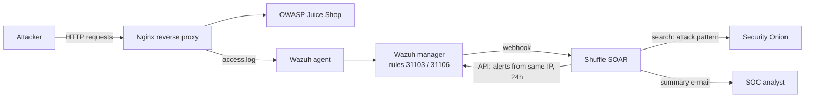

# SOC Home Lab – Wazuh + Shuffle (SIEM → SOAR)

A hands-on SOC lab I built during my studies as an **IT Security Analyst (SOC)** student at KYH Malmö.
It detects web attacks against a vulnerable web application, **enriches every alert automatically**, and sends the analyst a short, readable summary by e-mail.

> **Author:** Abdalrahman (Rio) Al-Dulaimi · Malmö, Sweden · [LinkedIn](https://linkedin.com/in/abdalrahman-al-dulaimi-563893362)
> Looking for an LIA / internship in SOC or detection & response from **7 Dec 2026 – 23 Apr 2027**.

---

## What the lab does

1. An attacker sends SQL injection and path traversal requests to **OWASP Juice Shop**.
2. **Nginx** sits in front of Juice Shop as a reverse proxy and writes every request to its access log.
3. A **Wazuh agent** on the proxy ships the log to the **Wazuh manager**, where the built-in web rules fire.
4. Alerts above a set level are sent by webhook to **Shuffle (SOAR)**.
5. Shuffle **enriches** the alert:
   - asks the Wazuh API how many alerts the same source IP produced in the last 24 hours
   - searches **Security Onion** for network events with the same attack pattern
6. Shuffle sends the analyst an e-mail with the alert, the enrichment and a triage hint.



## Example output

This is a real alert e-mail produced by the lab (attacker IP replaced with a documentation address, the rest unchanged):

```text
Alert:   A web attack returned code 200 (success).
Rule:    31106 (level 6)
Agent:   nginx-proxy
Source:  203.0.113.50
URL:     /rest/products/search?q=qwert'))+UNION+SELECT+name,type,'3','4','5','6','7','8','9'+FROM+sqlite_master--
HTTP:    200

Wazuh enrichment:          12 alerts from the same IP in the last 24 hours.
Security Onion enrichment: 0 network events with the UNION pattern
                           (matching is done on the attack pattern, not on the IP address).

Note: the Wazuh level does not tell you whether the attack succeeded. Review the request itself.
```

More samples: [`samples/alert-emails.md`](samples/alert-emails.md)

## Key findings

### 1. The "severity paradox" – successful attacks scored *lower* than failed ones

| Request | Result | Wazuh rule | Level |
|---|---|---|---|
| `?q=apple' UNION SELECT 1--` | HTTP 500 – **failed** | 31103 *SQL injection attempt* | **7** |
| `?q=apple' UNION SELECT * FROM users--` | HTTP 500 – **failed** | 31103 *SQL injection attempt* | **7** |
| `?q=qwert')) UNION SELECT name,type,… FROM sqlite_master--` | HTTP 200 – **succeeded**, database schema returned | 31106 *A web attack returned code 200* | **6** |

The one request that actually leaked data got the **lowest** severity. An analyst who sorts by level would look at the failed attempts first.
This is why the Shuffle e-mail always ends with a reminder to read the request itself, and why I wrote a [proposed escalation rule](wazuh/local_rules.xml).

### 2. Blind spot: POST bodies are not inspected

The Wazuh web rules read the **access log**, which contains the URL but not the request body.
A SQL injection sent in a `POST` body (for example the Juice Shop login form) produces no SQL injection alert at all.

Logging full request bodies is **not** the answer – it would put passwords and tokens into the logs. The recommended fix (thanks to feedback on LinkedIn) is an **application-side authentication event** with only the decision, the account and a correlation ID that links it to the proxy log, never secrets – and an end-to-end test that it reaches the analyst. Details in [`docs/findings.md`](docs/findings.md#recommended-fix-an-application-side-authentication-event).

### 3. Network vs. host visibility

The Security Onion search returned **0 events** for the UNION pattern, while Wazuh caught every request.
Network sensors only see what passes their capture interface, and traffic inside the Docker network or over TLS may never reach them. Host logs and network data complement each other; neither is enough alone.

Full write-up: [`docs/findings.md`](docs/findings.md)

## MITRE ATT&CK mapping

| Technique | ID | Seen in the lab |
|---|---|---|
| Exploit Public-Facing Application | [T1190](https://attack.mitre.org/techniques/T1190/) | SQL injection against `/rest/products/search` |
| File and Directory Discovery | [T1083](https://attack.mitre.org/techniques/T1083/) | Path traversal attempts for `/etc/passwd` |
| Data from Information Repositories | [T1213](https://attack.mitre.org/techniques/T1213/) | Dumping table names from `sqlite_master` |

## Repository layout

| Path | Content |
|---|---|
| [`lab/`](lab/) | Docker Compose for Juice Shop + Nginx, Nginx config, Wazuh agent log config |
| [`wazuh/`](wazuh/) | Integration config for the Shuffle webhook and a proposed custom rule |
| [`shuffle/`](shuffle/) | Workflow description and the Python enrichment/formatting step |
| [`docs/`](docs/) | Setup guide, findings and lessons learned |
| [`samples/`](samples/) | Sanitised alert e-mails produced by the lab |
| [`screenshots/`](screenshots/) | Screenshots of Wazuh, Shuffle and the e-mails |

## Skills shown

SIEM (Wazuh) · SOAR (Shuffle) · alert triage and enrichment · web attack detection · Docker · Nginx · Python · Security Onion · MITRE ATT&CK · detection gap analysis

## Disclaimer

Everything here ran in an isolated lab against an intentionally vulnerable application. Do not use these techniques against systems you do not own or have permission to test.
