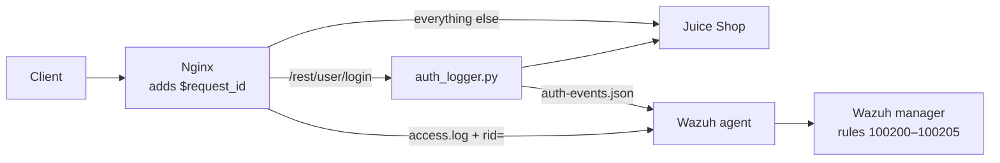

# Application-side authentication events

Closes the **POST body blind spot**: a SQL injection in the Juice Shop login form never appears in the Nginx access log, so the built-in Wazuh web rules cannot see it.

Instead of logging full request bodies (which would put passwords and tokens in the logs), a small proxy writes **one structured event per login attempt**:

```json
{"auth_event": "login", "decision": "failure", "http_status": 401, "account": "test@example.com",
 "src_ip": "172.18.0.1", "correlation_id": "17c81ebd0428d3a6162d294ca5dc6f36",
 "user_agent": "curl/8.5.0", "timestamp": "2026-10-17T19:30:05+00:00"}
```

Never logged: the password, tokens, or the rest of the request/response body.

## How it fits together



## Files

| File | Purpose |
|---|---|
| [`auth_logger.py`](auth_logger.py) | Python (standard library only) proxy for the login endpoint; writes the JSON event |
| [`nginx-default.conf`](nginx-default.conf) | Routes the login endpoint through the logger and adds `rid=$request_id` to the access log |
| [`entrypoint.sh`](entrypoint.sh) | Starts the logger, the Wazuh agent and Nginx in the proxy container |
| [`wazuh-agent-localfile.xml`](wazuh-agent-localfile.xml) | Makes the agent read the JSON file |
| [`../wazuh/auth_events_rules.xml`](../wazuh/auth_events_rules.xml) | Detection rules on the Wazuh manager |

In the proxy container's Dockerfile, `python3` is added to the installed packages and `auth_logger.py` is copied to `/opt/`.

## Rules

| ID | Level | Detects |
|---|---|---|
| 100201 | 3 | Failed login |
| 100202 | 3 | Successful login |
| 100203 | 8 | Failed login with a SQL injection pattern in the account field |
| **100204** | **12** | **Successful login with a SQL injection pattern → possible authentication bypass** |
| 100205 | 10 | 5 failed logins for the same account within 2 minutes (brute force) |

## Test results (17 Oct 2026)

| Test | Result |
|---|---|
| Failed login with curl | Event written with `decision: failure`; password not in the log ✅ |
| 5 failed logins on one account | 4 × rule 100201, then rule **100205** (level 10) ✅ |
| Course attack chain, phase 5 (login bypass via SQLi in the e-mail field) | Bypass succeeded → rule **100204** (level 12) ✅ – the course script itself expected *"probably no alert"* for this phase |
| Correlation ID | Same ID found in `auth-events.json` and in the Nginx access log line ✅ |

## Lesson learned: rule collision

The first version used a field called `event_type`. The event decoded correctly, but **no alert fired**. `wazuh-logtest` showed why: Wazuh's built-in Suricata rule **86600** matches *any* JSON with `timestamp` and `event_type` fields, so the event was routed into the Suricata rule tree and never reached the custom rules. Renaming the field to `auth_event` fixed it.

Takeaway: when adding custom JSON logs, test them with `wazuh-logtest` and check **which rule actually matches**, not only that the decoder works.
