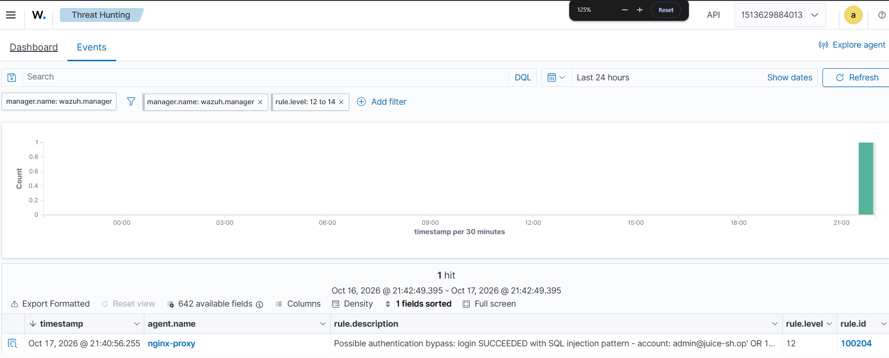

# Findings and lessons learned

## 1. Severity paradox

During testing, failed SQL injection attempts (HTTP 500) triggered **rule 31103 at level 7**, while the one request that actually returned the database schema (HTTP 200) triggered **rule 31106 at level 6**.

**Why it matters:** analysts often sort or filter by severity. Here the real compromise would be reviewed *after* the noise.

**What I did about it:**
- The Shuffle summary always shows the HTTP status and ends with a reminder that the level does not show success.
- I wrote a [proposed custom rule](../wazuh/local_rules.xml) that raises a level 12 alert when 31106 fires on a `UNION SELECT` request.

## 2. POST body blind spot

Wazuh's web rules analyse the access log line. The log contains the URL and status code but **not the request body**. SQL injection in a POST body, such as a login form, therefore produces no SQL injection alert.

### Recommended fix: an application-side authentication event

My first idea was to log more of each request. A reader on LinkedIn pointed out why that is the wrong direction: **logging full request bodies would put passwords and tokens into the logs**, which creates a new security and GDPR problem, adds a lot of noise and is hard to analyse.

The better fix is to let the **application** emit one small, structured event for every login attempt, with only what the analyst needs:

| Field | Why |
|---|---|
| `decision` | `success` or `failure` – the outcome the proxy log cannot see |
| `account` | which account was targeted |
| `correlation_id` | the same ID is added to the proxy log, so the event can be joined with the Nginx line and network data |
| `src_ip`, `timestamp` | for grouping and timelines |
| **never** | passwords, tokens, session cookies or other secrets |

Example event from the lab (implemented and tested 17 Oct 2026 – see [`auth-logging/`](../auth-logging/)):

```json
{
  "auth_event": "login",
  "decision": "failure",
  "http_status": 401,
  "account": "test@example.com",
  "src_ip": "172.18.0.1",
  "correlation_id": "17c81ebd0428d3a6162d294ca5dc6f36",
  "timestamp": "2026-10-17T19:30:05+00:00"
}
```

With this event Wazuh can alert on patterns such as many failures for one account, failures from one IP across many accounts, or a success right after a burst of failures – without a single secret in the logs.

**The last step matters:** test end to end that the event really reaches the analyst's view in Wazuh, instead of assuming it does.

**Result:** when the course attack chain ran its login bypass (SQL injection in the e-mail field), the bypass succeeded and Wazuh raised **rule 100204 at level 12 – "Possible authentication bypass"**. The course script itself expected *"probably no alert"* for that phase. Five failed logins on one account raised **rule 100205 (brute force)**, and the correlation ID linked each event to its Nginx log line.



**Other ways to narrow the gap:**
- a WAF or ModSecurity in front of the application, sending its alerts (not full bodies) to Wazuh
- network inspection with Suricata/Zeek, when the traffic is visible and not encrypted

## 2b. Rule collision (lesson learned while implementing the fix)

The first version of the event used a field called `event_type`. Wazuh decoded it correctly, but **no alert fired**. `wazuh-logtest` showed that the built-in Suricata rule **86600** matches any JSON with `timestamp` and `event_type`, so the event went into the Suricata rule tree and never reached my rules. Renaming the field to `auth_event` fixed it. Lesson: always check *which rule* matches a new log source, not only that it decodes.

## 3. Host and network data complement each other

Security Onion reported **0 network events** for the same attack pattern that Wazuh detected every time. In a containerised lab, much of the traffic never crosses the interface the sensor listens on. In a real network, TLS has a similar effect. A SOC needs both host logs and network data, and needs to know where each one is blind.

## 4. Enrichment saves triage time

Seeing "12 alerts from the same IP in the last 24 hours" next to the alert immediately turns a single event into a pattern. That is the decision an analyst would otherwise make by searching manually.

## What I would add next

- Test and tune the proposed rule with `wazuh-logtest`
- Add a case in a case-management tool (for example TheHive or Security Onion cases) instead of only e-mail
- Automatic IP reputation lookup (for example AbuseIPDB) for external sources
- Send the level 12 authentication bypass alert to Shuffle for enrichment and e-mail, like the web alerts
- Add a rule for a successful login right after several failures from the same IP
